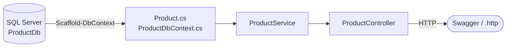

<div align="center">

# DbFirst — Database-First Web API

**Mövcud verilənlər bazasından EF Core modelinin yaradılması (Database-First) və HTTP sorğuları ilə CRUD nümunəsi**


</div>

---

## 📌 Haqqında

Bu öyrənmə layihəsi EF Core-da **Database-First** yanaşmasını göstərir: əvvəlcə SQL Server-də cədvəl yaradılır,
sonra `Scaffold-DbContext` əmri ilə ondan C# modeli (`Product`) və `DbContext` avtomatik generasiya olunur.
Üzərində `Product` üçün **CRUD** əməliyyatları edən Web API qurulub və HTTP sorğuları ilə sınanır.

---

## 🔄 Code-First və Database-First fərqi

| | Code-First | **Database-First** (bu layihə) |
|---|---|---|
| Başlanğıc nöqtəsi | C# sinifləri | Mövcud verilənlər bazası |
| Model necə yaranır | Əl ilə yazılır | `Scaffold-DbContext` ilə generasiya olunur |
| Baza necə dəyişir | Migration-lar | Bazada dəyişib yenidən scaffold edilir |
| Nə vaxt uyğundur | Yeni layihə | Hazır bazası olan layihə |



---

## 🔌 API endpoint-ləri

| Metod | Təsvir |
|---|---|
| `GET` | Bütün məhsullar |
| `GET` | ID ilə məhsul |
| `POST` | Məhsul əlavə et |
| `PUT` | Məhsulu yenilə |
| `DELETE` | Məhsulu sil |

`Product` modeli: `Id`, `Name`, `Price`.

---

## 🧰 Texnologiyalar

| Sahə | Texnologiya |
|---|---|
| Platforma | .NET 8, ASP.NET Core Web API |
| ORM | Entity Framework Core (Database-First) |
| Verilənlər bazası | SQL Server |
| Mapping | AutoMapper |
| API sənədləri | Swagger |

---

## 📁 Struktur

```text
DbFirstAndHttpRequest/
├── Controllers/ProductController.cs
├── Data/ProductDbContext.cs        ← scaffold ilə yaradılıb
├── Models/Product.cs               ← scaffold ilə yaradılıb
├── IServices/IProductService.cs
├── Services/ProductService.cs
└── Program.cs
```

---

## 🚀 İşə salma

1. SQL Server-də `ProductDb` bazasını və `Products` cədvəlini yarat
2. Modeli bazadan generasiya et (Package Manager Console):

```powershell
Scaffold-DbContext "Server=localhost;Database=ProductDb;Integrated Security=True;TrustServerCertificate=True" Microsoft.EntityFrameworkCore.SqlServer -OutputDir Models -ContextDir Data
```

3. `appsettings.json`-da `DefaultConnection` dəyərini təyin et və işə sal:

```bash
dotnet run
```

4. Swagger-də və ya `DbFirst.http` faylı ilə sorğuları sına

---

<div align="center">
  <sub>EF Core Database-First öyrənmə layihəsi</sub>
</div>
